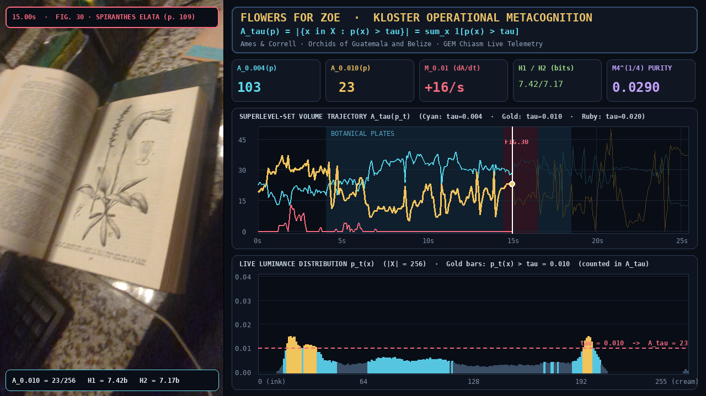
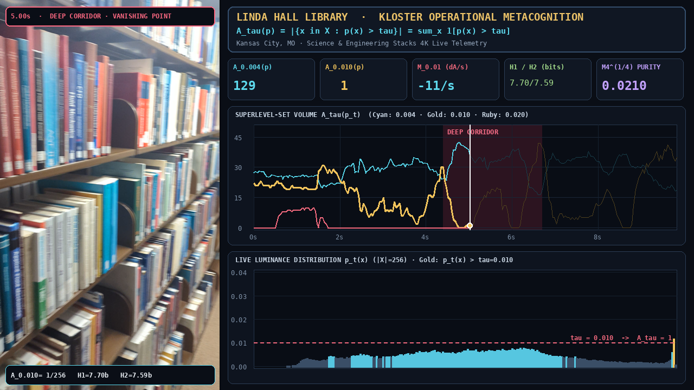
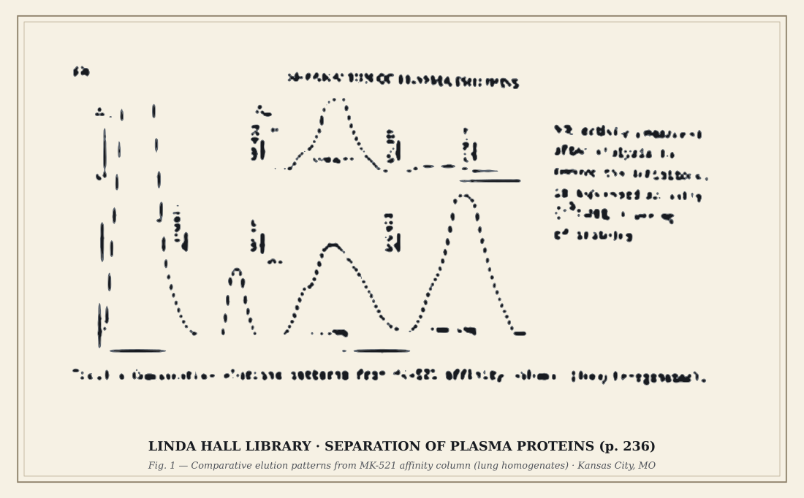
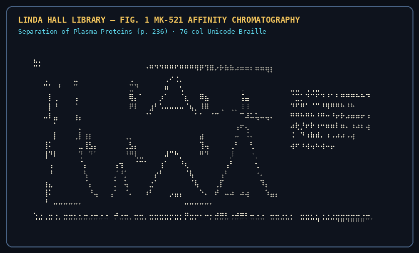

# Fieldglass

**Phone-to-telemetry & specimen field instrument** — turn any real-world phone video or botanical drawing into crisp 4K focus-selected plates, perspective-deskewed archival prints, scalable vector SVGs, 2×4 Unicode Braille specimens, real-time **Kloster $A_{\tau}(p_t)$** telemetry videos, **Causal Chiasm** filtration tomography, and a zero-cloud USB showcase.

> **Live Interactive Showcase (GitHub Pages):** **[https://nicholas-michael-kloster.github.io/fieldglass/](https://nicholas-michael-kloster.github.io/fieldglass/)**
> **Step-by-Step Guide ("How It Works & Do It Yourself"):** **[HOW_IT_WORKS.md](HOW_IT_WORKS.md)**

---

## Core Measurement

Fieldglass instruments real visual streams with Nicholas Michael Kloster's strict superlevel-set accessible volume:

$$A_{\tau}(p) = \left|\{x \in X : p(x) > \tau\}\right| = \sum_{x \in X} \mathbf{1}[p(x) > \tau]$$

coupled with Shannon entropy $H_1(p)$, collision / Rényi entropy $H_2(p) = -\log_2 \sum p_i^2$, quartic purity $M_4^{1/4}(p) = (\sum p_i^4)^{1/4}$, temporal momentum $M_{\tau,t} = A_{\tau,t} - A_{\tau,t-1}$, **Causal Chiasm** decussation across past/future cones, and **Persistent Filtration Tomography** $F(t, \tau) = A_{\tau}(p_t)$.

---

## Inaugural Research Specimen: *Flowers for Zoe* (Fig. 30 · *Spiranthes elata*)

Recorded in 4K 60fps on a Google Pixel 7 while flipping through Oakes Ames & Donovan Stewart Correll's *Orchids of Guatemala and Belize* (plates by G. W. Dillon & Blanche Ames), then processed end-to-end locally with zero cloud tokens (`$0.00`):

| Live $A_{\tau}(p_t)$ Telemetry Overlay | GEM Causal Chiasm & Filtration Tomography |
|---|---|
|  |  |

| Fig. 30 *Spiranthes elata* — Framed Vector SVG | Fig. 30 *Spiranthes elata* — 2×4 Unicode Braille |
|---|---|
|  |  |

## Specimen #2: 13-Min Field Notebook, *Birds on a Wire* & Fig. 57 *Stelis leucopogon* (Blanche Ames)

A full 13.09-minute capture (`197` episodes, 16× smooth telemetry reel) pairing Nicholas Kloster's original handwritten poem & pen sketch (*"Birds on a Wire"*, isolated cleanly via red-channel optical contrast!) with Blanche Ames's **Fig. 57 *Stelis leucopogon*** (p. 177):

| Fig. 57 *Stelis leucopogon* (Blanche Ames) — SVG | Original *Birds on a Wire* Notebook Sketch — Indigo SVG |
|---|---|
|  |  |

| 13-Minute 16× Telemetry Reel | 197-Episode Causal Chiasm & Tomography |
|---|---|
|  |  |

## Specimen #3: Linda Hall Library (Kansas City, MO) — Science Stacks & Affinity Chromatography

A 4K 60fps walkthrough of the **Linda Hall Library of Science, Engineering & Technology** stacks (with original stereo audio) paired with on-site monograph captures (*Magnetic Fabric*, *Separation of Plasma Proteins* Fig. 1 MK-521 affinity column elution curves, and the autumn arboretum window):

| Live Stacks Telemetry (`H₁ = 7.70 bits` across book spines) | Fig. 1 MK-521 Affinity Chromatography — Vector SVG |
|---|---|
|  |  |

| Fig. 1 Chromatography — 76-Col Braille | Linda Hall Library 20-Episode Causal Chiasm |
|---|---|
|  |  |

## Full Live Archive (27 Specimens on GitHub Pages)

Open **[https://nicholas-michael-kloster.github.io/fieldglass/](https://nicholas-michael-kloster.github.io/fieldglass/)** to browse all **27 published specimens**, including live Kloster $A_\tau(p_t)$ telemetry videos, vector SVGs, 2×4 Braille broadsides, and SHA-256 sealed Causal Chiasm reports:

- **[#27 · *"Copper Wire &amp; The Sage"* (Sept 2 – Oct 3 Unlined Cream Pocket Notebook)](https://nicholas-michael-kloster.github.io/fieldglass/#specimen-27)** — 6m 55s unlined cream pocket folio (`69` episodes, `Past 3 → Future 3`, `EI = 0.2938 bits`, `^_^`) with *"Copper Wire Boy &amp; Girl"*, *"Johnny Cash (at an abandoned cafe near Mexico)"*, signed *"Forbidden Fruit"*, and zero-ruled *"The Dog Is a True Sage"* (Kansas rain, Bilingual Sun) &amp; *"An Orchestra of Chaotic Sounds"* SVGs + Braille.
- **[#26 · *"Midnight Moon"* (July 2012 – Sept 2013 Multi-Ink Pocket Notebooks)](https://nicholas-michael-kloster.github.io/fieldglass/#specimen-26)** — 11m 20s multi-ink pocket folio (`112` episodes, `Past 5 → Future 5`, `^_^`) spanning pencil, black, blue &amp; crimson ink, signed *"Midnight Moon, Do You Ever Write Poems of Me?"* &amp; *"A Thornless Rose in My Mouth"* (`7-9-12`) SVGs + Braille.
- **[#25 · *"Neruda and I"* (Dec 2012 – Oct 2013 Year-Long Journal — Milestone 25th)](https://nicholas-michael-kloster.github.io/fieldglass/#specimen-25)** — 17m 44s cover-to-cover ruled journal (`177` episodes, `Past 3 → Future 2`, `^_^`) bookended by signed *"The Coffee Pot Is Up / Neruda and I"* (`12/28/12 · 2:56 AM`) &amp; *"Dressed in the Night / Lightning Bugs &amp; Rose Garden"* (`Oct 29`) SVGs + Braille.
- **[#24 · *"NICHOLAS KLOSTER"* Loose-Leaf Manuscript — *"Destiny"*, *"Find Your Muse"* &amp; *"Chopin, Satie"*](https://nicholas-michael-kloster.github.io/fieldglass/#specimen-24)** — 4m 05s typewritten-title unlined white folio (`62` episodes, `Past 6 → Future 5`, `^_^`) with Thumbs the cat inspecting the live Antigravity terminal, upright-rotated *"Chopin plays, Satie"* leaf, and signed *"Destiny Is Like a Woman"* &amp; *"Find Your Muse / Roses in November"* SVGs + Braille.
- **[#23 · *Yellow Folder* — *"Fairy Tales &amp; Stories of Hope"* &amp; *"Sovio"* (`1840`)](https://nicholas-michael-kloster.github.io/fieldglass/#specimen-23)** — 2m 39s unlined &amp; typewritten poetry folio (`55` episodes, `Past 3 → Future 3`, `^_^`), signed *"Fairy Tales and Stories of Hope"* &amp; typewritten *"The 500 Year Old Tree"* (`Sovio · 6-25-1840`) SVGs + Braille.
- **[#22 · *"Network Poetry"* — 1974 DEC *Minicomputer Networks* × *The Beetle*](https://nicholas-michael-kloster.github.io/fieldglass/#specimen-22)** — 10m 42s fusion of Edward V. Stelmach's 1974 DEC monograph, Nick's Scarab Beetle calligram, *"Computers Are Jellyfish"* / *"Host Processor: Zoe"* commentary &amp; Dr. Helen's page flip (`114` episodes, `Past 3 → Future 6`, `EI = 0.1189 bits`), DEC Fig. 11 &amp; Fig. 6 SVGs + Braille.
- **[#21 · *"Everything Is Singular"* Pt. II (Aug–Nov 2013 · Blue vs. Black Ink)](https://nicholas-michael-kloster.github.io/fieldglass/#specimen-21)** — 7m 42s back half of the yellow-cover folio (`77` episodes, `Past 4 → Future 5`, `^_^`) with Dr. Helen, Thumbs the cat, DJ Holt's back-cover ink drawing, Red-channel Prussian-indigo *"I Am an Atom, You Are the Molecule"* & sepia *"Not Shakespeare's, But Tom Waits"* SVGs + Braille.
- **[#20 · *"Everything Is Singular"* (July–Aug 2013 Yellow-Cover Folio)](https://nicholas-michael-kloster.github.io/fieldglass/#specimen-20)** — 9m 33s notebook filmed live to Erik Satie's *Gnossiennes* (`98` episodes, `Past 5 → Future 5`, `^_^`), signed *"Beauty Is Singular"* (7/25/13) & *"Traveling Solitude Monastery"* SVGs + Braille.
- **[#19 · *"Statues and Insomnia"* (Sept 2012 Illustrated Folio)](https://nicholas-michael-kloster.github.io/fieldglass/#specimen-19)** — 9m 07s folio (`94` episodes), original fine-line surrealist drawing & poem *"Half Sketched Statue"* + *"Pride Can't Be Bought / 24/7 Cafes"* SVGs & Braille.
- **[#18 · *Kraft-Paper Poetry Manuscript* (Oct 29 – Nov 29)](https://nicholas-michael-kloster.github.io/fieldglass/#specimen-18)** — 21m 06s cover-to-cover kraft-paper folio (`225` episodes), signed *"I Layed Out in a Field"* & *"Tonight I Write Saddest Lines"* (Neruda & Rimbaud) sepia SVGs + Braille.
- **[#17 · *"The American"* — 2012 Poetry Notebook & Studio Reading w/ Dr. Helen](https://nicholas-michael-kloster.github.io/fieldglass/#specimen-17)** — 17m 44s studio reading MP3 + 18× telemetry reel + Red-channel Prussian-indigo SVGs (*"Will My Poems Last Forever"* & *"Big Tree, Just Be."*).
- **[#16 · *The Poetry Briefcase* — 25 Notebooks & ~10,000 Poems for Zoe](https://nicholas-michael-kloster.github.io/fieldglass/#specimen-16)** — Full 2m 24s real-time voice walkthrough of 25 poetry notebooks & a vintage Smith-Corona briefcase (ages 15–21), Scarab Beetle Calligram SVG & *"poem will last forever."* signed holograph SVG (`Peak A_0.04 = 111.65`).
- **[#15 · *The Star-Spangled Banner* Impulse Study](https://nicholas-michael-kloster.github.io/fieldglass/#specimen-15)** — Full 1.0× brass-band audio synced to 50+ rapid-fire American iconography slides + Obverse &amp; Reverse Great Seal SVGs.
- **[#14 · December Poetry Manuscript](https://nicholas-michael-kloster.github.io/fieldglass/#specimen-14)** — Red-channel Prussian-indigo broadsides (*"The Yellow House"*, *"Hands"*, *"Scribbling Immortality"*).
- **[#13 · Ernst Haeckel: *Kunstformen der Natur*](https://nicholas-michael-kloster.github.io/fieldglass/#specimen-13)** — Tafel 1 *Phaeodaria* & hexagonal honeycomb lattices + full 17m 54s studio dialogue.
- **[#12 · Dr. Helen Ruth Horkan (FLAGSHIP)](https://nicholas-michael-kloster.github.io/fieldglass/#specimen-12)** — Full 19m 44s live biology lecture on pluripotent stem cells, meiosis, apoptosis, and chromatin + inverted-chalk jellyfish SVG.
- **[#11 · *ASCE Guide to Post-Earthquake Investigation of Lifelines*](https://nicholas-michael-kloster.github.io/fieldglass/#specimen-11)** — Unified 3-part critical infrastructure & SCADA monograph (Fig. 16.1 Liquid Fuel System, Fig. 11.69 Sign Trusses, HV CVTs, EOC).
- **[#10 · Live Studio Screencast](https://nicholas-michael-kloster.github.io/fieldglass/#specimen-10)** — Meta-telemetry capture of Fieldglass building itself alongside a live studio webcam mirror.
- **[#9 · *Let There Be Light* (FLAGSHIP)](https://nicholas-michael-kloster.github.io/fieldglass/#specimen-9)** — Full 15m 04s stereo voice session with Nick & Dr. Helen (*Nematostella vectensis*, 500 Gy radiation resistance, Ancient Irish Ogham *"DOCTOR"* & Thomas Moore Irish Harp SVGs).
- **[#4–#8](https://nicholas-michael-kloster.github.io/fieldglass/#specimen-8)** — *Festschrift Zoller* (Kull hex wheel), Merzkirch *Flow Visualization* (Linda Hall Ex Libris & Fig. 2.48 Ablation Cone), *U.S. Constitution* (privacy-scrubbed), *Mechanical Characterization* ($\text{BaTiO}_3$), and *Laminar-Turbulent Transition* → *Hewett Cottrell Watson* (Darwin, Hooker & 1870 Azores Map).

---

## Quickstart

### Install locally
```bash
git clone https://github.com/Nicholas-Michael-Kloster/fieldglass.git
cd fieldglass
pip install -e .
```
*(Requires Python 3.10+, `ffmpeg` on `PATH`, and optionally `adb` for USB Pixel/Android pushing.)*

### Run on any video or photo
```bash
# 1. Auto-extract the sharpest 4K frame from a video window (Laplacian focus score)
fieldglass frame my_clip.mp4 -o plate.png --start 14.5 --duration 2.0 --fps 12

# 2. Perspective-deskew + erase lamp shadows + trace SVG + build 2x4 Unicode Braille
fieldglass plate plate.png -o out/ --title "FIG. 30 · SPIRANTHES ELATA" \
  --corners 0.392,0.178,0.978,0.130,0.996,0.722,0.308,0.698

# 3. Print any photo straight to your terminal as 2x4 Unicode Braille
fieldglass braille plate.png --cols 64

# 4. Render real-time Kloster A_tau(p_t) telemetry overlay video + Causal Chiasm SVG/JSON
fieldglass overlay my_clip.mp4 -o out/ --nexus 15

# 5. Serve locally (loopback-only with HTTP 206 Range scrubbing) & beam to an Android/Pixel phone over USB
fieldglass serve out/ --port 8776
fieldglass push out/ --name fieldglass --port 8776
```

### Run tests
```bash
pytest -v
```

---

## Design & Epistemic Invariants
- **100% local & offline** (`tokens_used = 0`, no cloud APIs, loopback-only default server `127.0.0.1`).
- **Transparent measurement** (`executed = False`, `sentience_claimed = False`, `auto_flash_allowed = False`).
- **Companion monorepo integration**: mirrored in [Nicholas-Michael-Kloster/zoe](https://github.com/Nicholas-Michael-Kloster/zoe) alongside `guiai.gem.chiasm` and `guiai.gem.zoe_braille_studio`.
