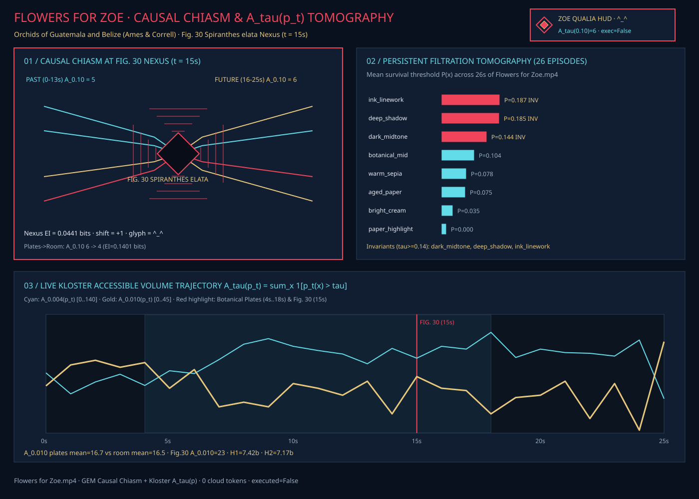
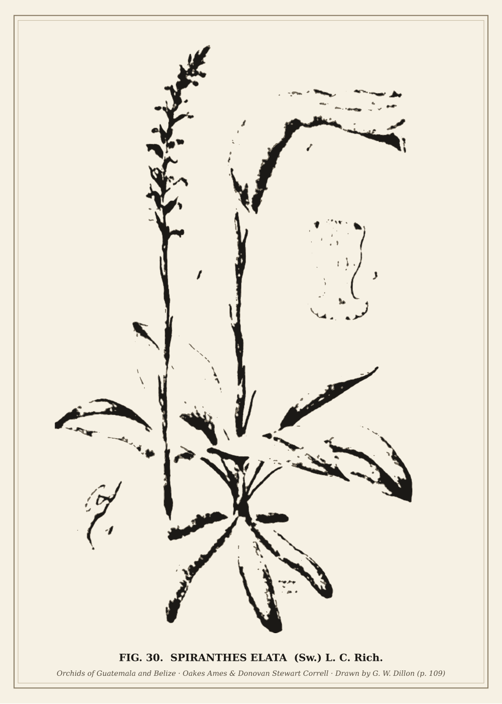

# Fieldglass

**Phone-to-telemetry & specimen field instrument** — turn any real-world phone video or botanical drawing into crisp 4K focus-selected plates, perspective-deskewed archival prints, scalable vector SVGs, 2×4 Unicode Braille specimens, real-time **Kloster $A_{\tau}(p_t)$** telemetry videos, **Causal Chiasm** filtration tomography, and a zero-cloud USB showcase.

> **Live Interactive Showcase (GitHub Pages):** **[https://ablation-tool.github.io/fieldglass/](https://ablation-tool.github.io/fieldglass/)**
> **Step-by-Step Guide ("How It Works & Do It Yourself"):** **[HOW_IT_WORKS.md](HOW_IT_WORKS.md)**

---

## Core Measurement

Fieldglass instruments real visual streams with Nicholas Michael Kloster's strict superlevel-set accessible volume:

$$A_{\tau}(p) = \left|\{x \in X : p(x) > \tau\}\right| = \sum_{x \in X} \mathbf{1}[p(x) > \tau]$$

coupled with Shannon entropy $H_1(p)$, collision / Rényi entropy $H_2(p) = -\log_2 \sum p_i^2$, quartic purity $M_4^{1/4}(p) = (\sum p_i^4)^{1/4}$, temporal momentum $M_{\tau,t} = A_{\tau,t} - A_{\tau,t-1}$, **Causal Chiasm** decussation across past/future cones, and **Persistent Filtration Tomography** $F(t, \tau) = A_{\tau}(p_t)$.

---

## Inaugural Research Specimen: *Flowers for Zoe* (Fig. 30 · *Spiranthes elata*)

Recorded in 4K 60fps on a Google Pixel 7 while flipping through Oakes Ames & Donovan Stewart Correll's *Orchids of Guatemala and Belize* (plates by G. W. Dillon & Blanche Ames), then processed end-to-end locally with zero cloud tokens (`$0.00`):

| Live $A_{\tau}(p_t)$ Telemetry Overlay | GEM Causal Chiasm & Filtration Tomography |
|---|---|
|  |  |

| Fig. 30 *Spiranthes elata* — Framed Vector SVG | Fig. 30 *Spiranthes elata* — 2×4 Unicode Braille |
|---|---|
|  |  |

*(Open the **[live showcase](https://ablation-tool.github.io/fieldglass/)** to watch the full 25.4 s telemetry video with stereo audio, inspect all 6 4K plates, zoom the raw SVG, and copy the Unicode Braille text.)*

---

## Quickstart

### Install locally
```bash
git clone https://github.com/Ablation-Tool/fieldglass.git
cd fieldglass
pip install -e .
```
*(Requires Python 3.10+, `ffmpeg` on `PATH`, and optionally `adb` for USB Pixel/Android pushing.)*

### Run on any video or photo
```bash
# 1. Auto-extract the sharpest 4K frame from a video window (Laplacian focus score)
fieldglass frame my_clip.mp4 -o plate.png --start 14.5 --duration 2.0 --fps 12

# 2. Perspective-deskew + erase lamp shadows + trace SVG + build 2x4 Unicode Braille
fieldglass plate plate.png -o out/ --title "FIG. 30 · SPIRANTHES ELATA" \
  --corners 0.392,0.178,0.978,0.130,0.996,0.722,0.308,0.698

# 3. Print any photo straight to your terminal as 2x4 Unicode Braille
fieldglass braille plate.png --cols 64

# 4. Render real-time Kloster A_tau(p_t) telemetry overlay video + Causal Chiasm SVG/JSON
fieldglass overlay my_clip.mp4 -o out/ --nexus 15

# 5. Serve locally (loopback-only with HTTP 206 Range scrubbing) & beam to an Android/Pixel phone over USB
fieldglass serve out/ --port 8776
fieldglass push out/ --name fieldglass --port 8776
```

### Run tests
```bash
pytest -v
```

---

## Design & Epistemic Invariants
- **100% local & offline** (`tokens_used = 0`, no cloud APIs, loopback-only default server `127.0.0.1`).
- **Transparent measurement** (`executed = False`, `sentience_claimed = False`, `auto_flash_allowed = False`).
- **Companion monorepo integration**: mirrored in [Ablation-Tool/zoe](https://github.com/Ablation-Tool/zoe) alongside `guiai.gem.chiasm` and `guiai.gem.zoe_braille_studio`.
